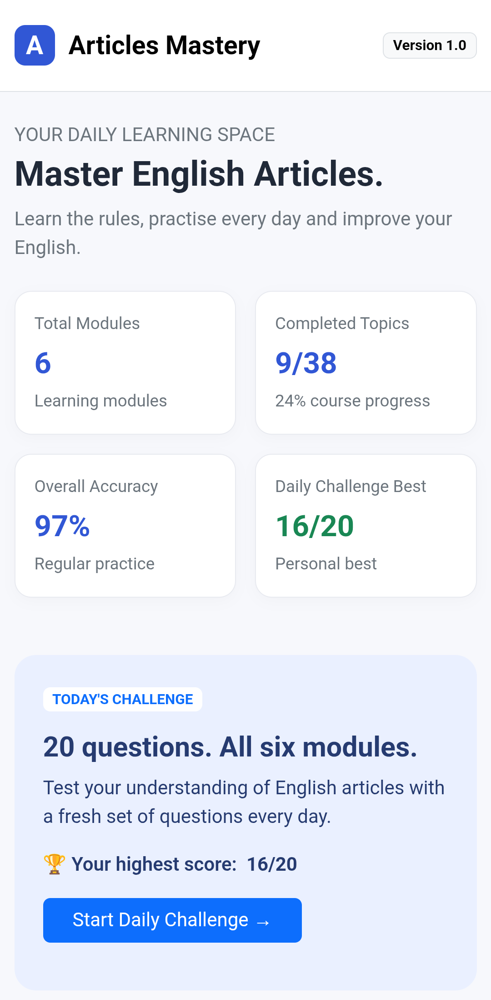
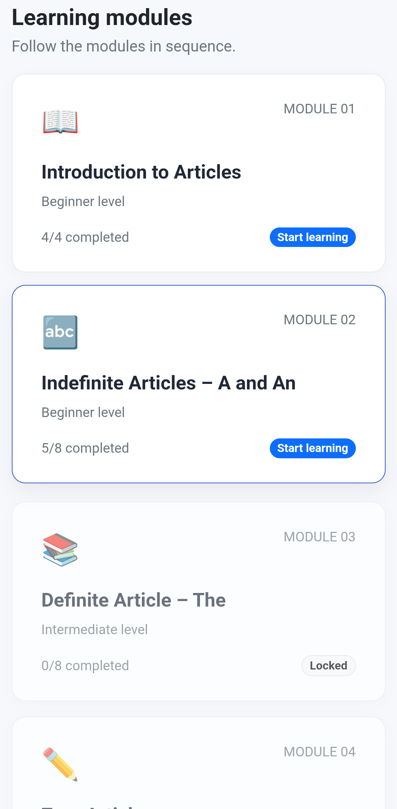
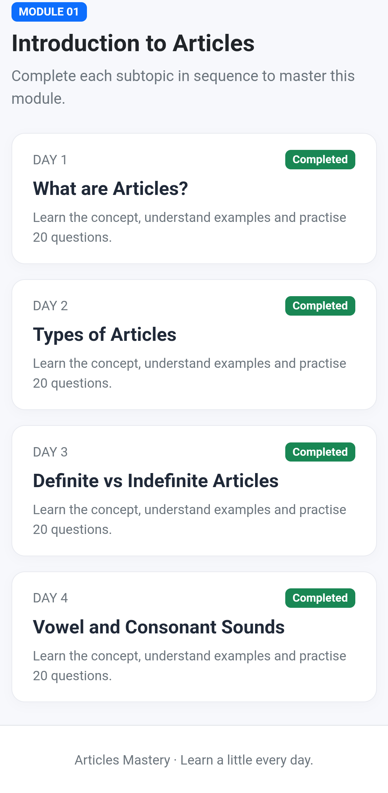
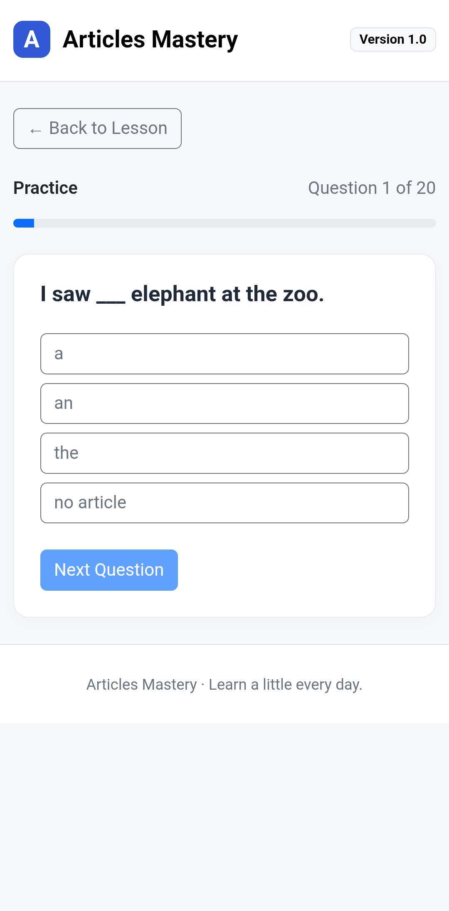
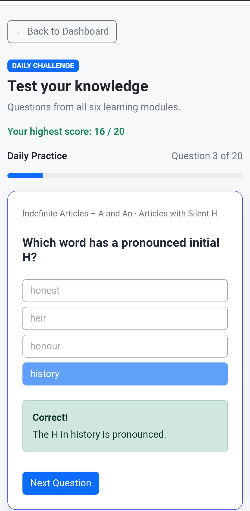

# Articles Mastery – English Grammar Learning App

Articles Mastery is an offline-first English grammar learning application designed to help learners understand and master the use of **A, An, The, and Zero Articles**.

The application provides structured lessons, topic-wise practice questions, daily challenges, and progress tracking to support consistent learning and exam preparation.

## Why I Created This Project

This project was driven by two goals:

**1. Strengthening Development Skills**

I wanted to refresh and strengthen my software development skills by building a complete application from scratch. Rather than limiting myself to individual coding exercises, I wanted practical experience in designing, developing, testing, and deploying an application.

**2. Building a Useful Learning Resource**

While preparing for competitive examinations, I wanted a dedicated platform to understand English articles (A, An, The, and Zero Articles), practise questions topic by topic, identify mistakes, and track learning progress.

This personal requirement became the motivation behind building Articles Mastery.

## AI-Assisted Development

ChatGPT was used as an AI-assisted development tool throughout the project for:
- Exploring implementation approaches and application architecture.
- Generating and refining code.
- Understanding errors and debugging issues.
- Improving existing features and developing new functionality.

The development process involved reviewing, testing, and refining the generated code to meet the project's requirements.

## Target Audience

Articles Mastery is designed for:

- **Competitive Exam Aspirants:** Students preparing for GATE, SSC, banking, placement aptitude tests, and other competitive examinations where English grammar is relevant.
- **Students:** School and college students looking to strengthen their English grammar fundamentals.
- **English Learners:** Beginners and intermediate learners who want to understand the correct usage of A, An, The, and Zero Articles.
- **Self-Learners:** Anyone who prefers structured lessons, independent practice, and regular revision.

## Features

- **Structured Learning:** Six learning modules covering the fundamentals and advanced rules of English articles.
- **Topic-wise Lessons:** Learn individual concepts through organised lessons.
- **Practice Mode:** Test your understanding with multiple-choice questions and explanations.
- **Daily Challenge:** Practise 20 randomly selected questions every day.
- **Progress Tracking:** Automatically save completed topics, practice scores, and accuracy.
- **Personal Best:** Track your highest Daily Challenge score.
- **Daily Reminder:** Get an in-app reminder to complete your daily challenge.
- **Reset Progress:** Reset learning progress and practice history when needed.
- **Offline-first:** Access lessons and question banks without requiring an internet connection.

## Screenshots

Add screenshots of the application in the `docs/screenshots/` folder.

| Dashboard | Learning Modules |
|---|---|
|  |  |

| Lesson View | Practice Mode |
|---|---|
|  |  |

| Daily Challenge | Progress Tracking |
|---|---|
|  |  |


## Technology Stack

| Technology | Purpose |
|---|---|
| React.js | User interface |
| JavaScript | Application logic |
| Vite | Development server and build tool |
| Bootstrap 5 | Responsive UI styling |
| CSS | Custom styling |
| JSON | Lesson content and question banks |
| Local Storage | Local progress persistence |
| Capacitor | Integrating the web application with Android |
| Android Studio | Android development and APK generation |

## Project Structure

```text
articles-mastery/
│
├── android/                  # Native Android project
├── public/
├── src/
│   ├── components/           # Reusable React components
│   ├── data/
│   │   ├── lessons/          # Lesson content
│   │   ├── questions/        # Question banks
│   │   └── syllabus/         # Learning syllabus
│   ├── App.jsx
│   ├── App.css
│   ├── index.css
│   └── main.jsx
│
├── capacitor.config.json
├── package.json
├── package-lock.json
└── README.md
```

## Installation and Setup

### Prerequisites

- Node.js and npm
- Git
- Android Studio (for Android development)

### 1. Clone the repository

```bash
git clone YOUR_GITHUB_REPOSITORY_URL
cd articles-mastery
```

### 2. Install dependencies

```bash
npm install
```

### 3. Run the web application

```bash
npm run dev
```

Open the local URL displayed in the terminal to access the application.

### 4. Build the web application

```bash
npm run build
```

### 5. Run on Android

Make sure Android Studio and the required Android SDK components are installed.

```bash
npx cap sync android
npx cap open android
```

Once Android Studio opens, wait for Gradle Sync to complete, start an emulator or connect an Android device, and click **Run**.

### 6. Generate an APK

In Android Studio:

1. Open the Build menu.
2. Select Generate APKs.
3. Wait for the build to complete.
4. Locate the generated APK.

## Learning Scope

The application covers six modules:

1. Introduction to Articles
2. Indefinite Articles – A and An
3. Definite Article – The
4. Zero Articles
5. Advanced Article Rules
6. Practice and Assessment

## Project Goal

The goal of Articles Mastery is to make English grammar practice more structured, accessible, and consistent through an interactive learning experience.

---

## Project Objective

The objective is to make learning English articles simple, structured, and consistent through:

- Concept-based learning.
- Topic-wise question practice.
- Immediate feedback and explanations.
- Daily revision and progress tracking.
- An offline-first learning experience.

The application aims to help learners build a strong understanding of article usage rather than simply memorising answers.